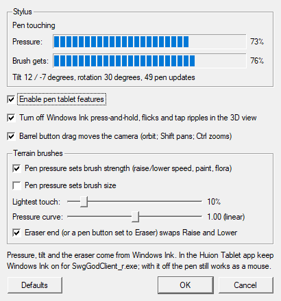

# God Client — pen tablet support (Huion Kamvas 13)

The God Client (`SwgGodClient_r.exe`) reads a Windows Ink pen directly: pressure drives the terrain
brushes, the eraser swaps Raise and Lower, and the barrel button moves the camera. It was built for a
Huion Kamvas 13 but works with any pen that Windows Ink drives (Wacom, XP-Pen, Surface).

**Sources:** `client/src/game/client/application/SwgGodClient/src/`

| File | Role |
|------|------|
| `GodClientPen.h/.cpp` | Reads the stylus from `WM_POINTER` (pressure, tilt, rotation, barrel, eraser). Opts the 3D view out of Ink gestures. Loads and saves the settings. |
| `TabletSettingsDialog.h/.cpp` | **Tools ▸ Pen Tablet Settings…**, with a live stylus readout. |
| `MainFrame.cpp` | `GodClientApplication::winEventFilter` passes every message to `GodClientPen::handleWindowsMessage`. It only watches them, so Windows still turns the pen into mouse input. |
| `GameWidget.cpp` | Ink gesture opt-out for the 3D view, barrel-drag camera, no cursor warps under the pen. |
| `TerrainDock.cpp` | `applyPenDynamics()` runs before every brush sample. Adds the **Pen pressure** row in Brush Settings. |
| `GodClientTerrainEditor.cpp` | `setBrushDynamics()` scales one brush sample (dab). The preview ring follows the pressure-scaled size and the swapped tool colour. |

## How it works

When Windows Ink is on, Windows turns pen input into ordinary mouse messages, so Qt 3 already sees
the pen: the tip is the left button, and barrel button + tip is the right button. Those mouse
messages lose pressure, tilt and the eraser. `GodClientPen` reads them from the `WM_POINTER` messages
that arrive just before the mouse messages, and keeps the latest stylus state.

A mouse handler can then ask:

- **`isPenEvent()`:** did this mouse message come from the pen? Pen mouse messages carry the
  `0xFF5157xx` signature in `GetMessageExtraInfo`.
- **`getState()`:** how hard is the pen pressed, is the barrel button held, is the eraser in use?

Qt 3 pins `_WIN32_WINNT` to Windows 2000, so the pointer API (Windows 8+) is declared locally and
loaded at run time. Without it, the pen keeps working as a plain mouse.

## Using the pen

| Pen action | Result |
|------------|--------|
| Tip | Same as the left mouse button: select, rubber-band, drag objects, paint terrain. |
| Tip pressure on a terrain brush | Scales the brush's strength and/or size for that brush sample (dab); see below. |
| Eraser end, or a pen button set to **Eraser** | Swaps **Raise** and **Lower**. The preview ring changes colour before you touch down. |
| Barrel button + tip, click | Context menu, the same as a right click. |
| Barrel button + tip, drag (more than 6 px) | **Orbit** the camera. Add **Shift** to **pan**, or **Ctrl** to **zoom** (drag right or up to zoom in). No context menu opens afterwards. |
| Alt + tip or barrel | The usual Maya-style Alt camera, unchanged. |
| Pen held still on the 3D view | Nothing. Windows Ink's press-and-hold right click is switched off in the 3D view, so a still pen does not pop up a menu mid-stroke. |

What pressure scales, per tool (from the dock values: the sliders give the strength and size at full pressure):

| Tool | Strength scaling | Size scaling |
|------|------------------|--------------|
| Raise / Lower | metres per dab (Raise/Lower speed) | yes |
| Flatten, Smooth, Noise | blend strength / noise amount | yes |
| Paint shader, vertex tint | paint strength | yes |
| Flora, Radial | density / child choice | yes |
| Set Height, Water | — | yes |
| Bitmap stamp, polylines, polygons, Select | — | — |

## Settings

Open **Tools ▸ Pen Tablet Settings…** (or **Tablet…** in the terrain dock's Brush Settings).
Settings are saved with the other God Client settings (Qt `QSettings`, group `Tablet`, under
`HKCU\Software\SOE\SwgGodClient`).

| Setting | Default | Notes |
|---------|---------|-------|
| Enable pen tablet features | on | Master switch. Turn it off and the pen is a plain mouse. |
| Turn off Windows Ink press-and-hold, flicks and tap ripples in the 3D view | on | Sets `MicrosoftTabletPenServiceProperty` and `SetWindowFeedbackSetting` on the 3D view only. Docks and lists keep press-and-hold. |
| Barrel button drag moves the camera | on | A barrel click still opens the context menu. |
| Pen pressure sets brush strength | on | Also on the dock's **Pen pressure: Strength** box. |
| Pen pressure sets brush size | off | Also on the dock's **Size** box. The size slider is the size at full pressure. |
| Lightest touch | 10% | The brush scale at the lightest pressure. |
| Pressure curve | 1.00 (linear) | Below 1 is soft (light touches count more); above 1 is firm. Range 0.25–4. |
| Eraser swaps Raise and Lower | on | |

The dialog shows the pen live: hovering or touching, raw pressure, what the brush gets with the
current settings, tilt, rotation and the update count. Use it to check that the driver is sending
Windows Ink data.

*Captured in the test harness, without the God Client's dark theme. With the defaults, 73% pressure
gives 10% + 90% × 0.73 = 76% brush strength.*

## Huion Kamvas 13 setup

1. In the **Huion Tablet** app, keep **Windows Ink** on for the Kamvas. To give the god client its
   own profile, add `SwgGodClient_r.exe` under the app settings and leave Windows Ink on there.
   With Windows Ink off, the driver emulates a mouse: the pen still works, but there is no
   pressure, eraser or barrel information.
2. Pen buttons: set the **lower** button to **Right click** (context menu click, barrel-drag
   camera). Set the **upper** button to **Eraser** (swaps Raise/Lower) or to **Middle click**
   (Alt + middle = zoom, the transform keys' "pull").
3. Suggested express keys for this editor:

   | Key | Map to | God Client use |
   |-----|--------|----------------|
   | K1 | Alt (hold) | Maya-style camera with the tip |
   | K2 | Ctrl (hold) | Toggle selection; pen zoom with the barrel |
   | K3 | Shift (hold) | Add to selection; pen pan with the barrel; with K5/K6, brush strength |
   | K4 | Space | Apply transform (commit the moved ghosts) |
   | K5 | `[` | Smaller terrain brush, or push the selection away |
   | K6 | `]` | Bigger terrain brush, or pull the selection closer |
   | K7 | Ctrl+Z | Undo (terrain strokes too while a terrain tool is armed) |
   | K8 | Ctrl+K | Command palette (or **Switch Monitor** to move the pen between displays) |

   To move objects from the tablet, swap two keys for the hold-to-transform keys: T (move),
   G (move along the ground), R (rotate) or S (scale), held while dragging. See
   [god-client-productivity.md](god-client-productivity.md) for `[`, `]`, Ctrl+Z and Ctrl+K.

4. When the Huion driver is **not** running, Windows drives the Kamvas as a standard HID pen. The
   tip, pressure and the barrel button (as right click) still work. The button and express-key
   mappings above come from the driver, so they need it running.

## Testing notes

- `GodClientPen.cpp` and `TabletSettingsDialog.cpp` were checked in a stand-alone Qt 3 x64 harness
  driven by `InjectSyntheticPointerInput`. Checked:
  - pen-vs-mouse detection;
  - the pressure ramp (0.10 → 0.98);
  - barrel → right button, with the context menu on release;
  - tilt and rotation, and leaving range;
  - DirectInput sees pen taps, so game-focus mode needs nothing extra;
  - the dialog's live readout.
- Not covered by the harness, so check these with the real pen on the Kamvas:
  - **The eraser.** Synthetic pens never report the eraser flags, so the eraser is only checked in
    code.
  - **The press-and-hold opt-out.** Synthetic pens do not trigger press-and-hold even without the
    opt-out, so this is untested.
  - **The God Client wiring** (terrain dynamics, barrel camera). The God Client signs in, so the
    automated sessions do not launch it. The build compiles and links.
- Synthetic pen coordinates are measured from the virtual desktop's top-left, not the primary
  monitor. Subtract `SM_XVIRTUALSCREEN` / `SM_YVIRTUALSCREEN`, or the input lands on another
  monitor.
