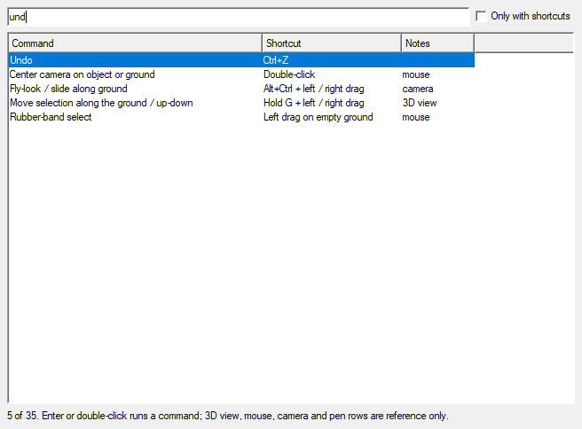

# God Client — productivity features

Shortcuts and tools added to the God Client (`SwgGodClient_r.exe`) to cut down on repeated clicks
when placing objects, sculpting terrain and running server commands. They all live in
`client/src/game/client/application/SwgGodClient/src/`.

Not sure where something is? Press **Ctrl+K**.

## At a glance

| Feature | How | Source |
|---------|-----|--------|
| Command palette | **Ctrl+K** (Help ▸ Command Palette…) | `CommandPaletteDialog.*`, `ActionsTool.cpp` |
| Keyboard cheat sheet | Help ▸ Keyboard Shortcuts… | `CommandPaletteDialog.*` |
| Undo / redo terrain strokes | **Ctrl+Z / Ctrl+Y** while a terrain tool is armed | `ActionsEdit::onUndo`, `TerrainDock::tryConsumeUndoShortcut` |
| Terrain brush size / strength | **[ / ]**; add **Shift** for strength | `GameWidget::keyPressEvent`, `TerrainDock::stepBrushSize` |
| Push / pull the selection along the view | **[ / ]** with no terrain tool armed | `GameWidget::keyPressEvent` → `pullSelection` |
| Repeat the last placement | **Ctrl+Shift+N** places it under the cursor | `GameWidget::placeLastTemplateAtCursor` |
| Recent templates | Right-click ▸ Recent Templates (12, kept across sessions) | `GameWidget.cpp` |
| Copy transform | **Ctrl+Shift+C** (also puts `x y z heading … scale …` on the clipboard) | `GodClientData::copySelectionTransform` |
| Paste position / rotation / all | **Ctrl+Shift+V** / **Ctrl+Alt+V** / Edit ▸ Paste Position, Rotation & Scale | `GodClientData::pasteSelectionTransform` |
| Select all with the same template | **Ctrl+Shift+M** | `GodClientData::selectObjectsWithTemplate` |
| Console command line | Type in the Console dock; **Up / Down** for history | `ConsoleWindow.cpp`, `ServerCommander::consoleCommand` |
| Viewport screenshot | **F12** (Tools ▸ Save Viewport Screenshot) | `ActionsTool::onScreenshot` |
| Camera bookmarks kept per planet | Automatic | `BookmarkData::setScene` |
| Compile a template and reload it live | ObjectTemplate ▸ Server/Client ▸ **Compile**, or the Template Editor's **Compile** | `ActionsObjectTemplate::compileTemplate`, `reloadClientTemplate` |
| Reload re-exported meshes live | Right-click ▸ **Reload Appearance** (ObjectTemplate ▸ Client ▸ Reload Appearance) | `ActionsObjectTemplate::reloadAppearances`, `AppearanceTemplateList::flush` |

## Details

### Command palette and cheat sheet

**Ctrl+K** opens a list of every menu command with its shortcut. Type a few letters of each
word, in any order: `rot 45`, `drop terr`, `paste pos`. Matches at the start of the command
come first. **Up/Down** move through the list; **Enter** or a double-click runs the command,
exactly as if you had clicked it in a menu (toggles flip too).

The list also includes the 3D view's built-in keys and gestures: hold T/G/R/S and drag, the Alt
camera, pen gestures and so on. Those rows are reference only. **Help ▸ Keyboard Shortcuts…** opens
the same list with **Only with shortcuts** ticked.

### Terrain

- **Ctrl+Z / Ctrl+Y** undo and redo terrain strokes when a terrain tool is armed and there is
  terrain history. Otherwise they undo object edits as before.
- **[ / ]** shrink or grow the brush (×1.25 per press, 1–256 m). **Shift+[ / ]** lower or raise
  the strength by 5%. The dock sliders follow, and the status bar shows the new value.
- These keys suit tablet express keys: see [god-client-pen-tablet.md](god-client-pen-tablet.md).

### Placing objects

- Every placement (Create Object…, drag-and-drop, Ctrl+N, the recent list) is remembered.
  **Ctrl+Shift+N** places the newest one again under the cursor and selects it.
  **Right-click ▸ Recent Templates** places any of the last 12 where you right-clicked. The
  list is saved (QSettings `RecentTemplates/list`).
- **[ / ]** with no terrain tool armed push the selection away from or pull it toward the camera,
  by 10% of its distance. These keys used to print "not implemented".

### Transforms

- **Copy Transform** remembers the primary selection's position, rotation and scale. If it has a
  ghost that hasn't been applied yet, it copies the ghost's values. The values also go on the
  clipboard as text, ready for scripts or the console.
- **Paste Position / Paste Rotation / Paste Position, Rotation & Scale** move every selected
  object's ghost. Apply with **Ctrl+T** or **Space** as usual, and undo works the same way.
- Positions are relative to the object's parent, as in the Set Transform dialog. Paste between
  objects in the same cell, or between objects outside any building.
- **Select All With Same Template** adds every loaded object built from the primary selection's
  template. The usual selection rules apply: the object needs an appearance and must be in the
  same cell as you.

### Console

The Console dock has a command line:

- `object get 1234` (anything without a leading `/`) goes to the server console, through the
  same channel the God Client's own commands use.
- `/command args` runs a slash command, targeting the first selected object if there is one.
- **Up / Down** recall the last 50 lines.

### Template compile and live reload

**Compile** compiles the selected template's `.tpf` and reloads the result, so you don't have to
restart. You'll find it under ObjectTemplate ▸ Server / Client, on the template toolbars, in the
template lists' right-click menus, and as the Template Editor's button.

1. The compile runs `[GodClient] templateCompileCommand` in the background, with the absolute
   `.tpf` path appended. The default is
   `wsl.exe -d Titan -u root -- env TITAN_NO_RELOAD=1 bash /mnt/d/titan/wsl/titan.sh sync`, the
   same `titan.sh sync` that `watch.ps1` and `make_templates.py` use. It writes
   `D:\titan\data\…\foo.iff` and copies it into the server's data mirror. It takes about half a
   second when WSL is already running.
2. Output streams into the Console, with lines starting `Templates:`. The status bar shows the
   outcome. A compile succeeds only if the command exits 0 **and** the `.iff` was rewritten.
   TemplateCompiler errors (such as `cannot find parameter …`) exit with 255 and reload nothing.
3. **Server template** (`sys.server`): the God Client sends `object reloadServerTemplate
   object/….iff`, the same command as **Server Reload**. Every game server reloads it, and the
   reply appears in the Console.
4. **Shared template** (`sys.shared`): `ObjectTemplateList::reload` reads the new `.iff` into
   the loaded template. Every placed object made from it, or from a template derived from it, then
   rebuilds its appearance the way its constructor did: `TangibleObject::changeAppearance`, plus
   the server's customization string and fresh collision extents. An object with a walkable
   floor leaves the collision world while it changes and comes back with a floor built from the
   new appearance. A creature standing on the old floor is detached from it, as when the server
   deletes the object. Selection ghosts get the new appearance too. The Console says how many
   objects were refreshed and why any were skipped.

The Template Editor's **Compile** compiles both halves it has on disk, shared first. It compiles
the saved files, so press **Save** first. **Edit** and **View** in the ObjectTemplate menus now
open the selected `.tpf`. They used to pass a path the editor could not open.

These need a God Client restart, or re-placing the object:

- **A changed template class or `@base`.** The reload is refused with a message. Live objects
  hold reference counts against the old base, so swapping it in place is unsafe.
- **Skipped placed objects:** creatures, ships, buildings and cells (their portal layout isn't
  reloaded), items worn or inside a container, and objects attached to another object. Re-place
  these objects to see the change.
- **Values computed once from the template.** These are the client data file (hardpoint
  children), slot and arrangement descriptors, the structure footprint and the object's name. A
  parameter you delete keeps its old value. A screen or painting gets its remote texture back
  when it is re-placed.
- **Edits to the appearance files themselves** (`.apt`, `.lod`, `.msh`). Compile covers template
  edits, such as pointing `appearanceFilename` at a different `.apt`. For changed appearance
  files, use **Reload Appearance** (below).
- **A copy with a higher search priority.** If another search path has the same `object/….iff`,
  for example `D:\exported` (searchPath12), the client loads that copy. Nothing is reloaded, and
  the Console names the copy that wins.
- **New templates.** They compile, but the server and clients only know them after `titan crc`
  and a restart. Shared templates are not reloaded on the server; `titan.sh` skips that too.

Without WSL, point `templateCompileCommand` at any command that takes the `.tpf` path as its last
argument and writes the matching `data/…/….iff`.

### Reload Appearance

After you re-export a mesh, for example from Maya to `D:\exported`, select one object that uses it
and choose **Reload Appearance**. It's in the 3D view's right-click menu when something is
selected, under ObjectTemplate ▸ Client, and in the **Ctrl+K** palette. You don't need to restart.

1. The God Client collects the files the selected objects' appearances are built from: the
   template's `appearanceFilename` (usually an `.apt`), the `.lod` or `.cmp` it points to, and
   their `.msh` levels and parts.
2. The Console lists each file with the copy on disk that will load, under a line starting
   `Appearances:`. If a copy on a higher search path shadows your export, it shows up there.
3. `AppearanceTemplateList::flush` drops those files from the appearance cache. Appearances that
   still use the old files keep them until they are rebuilt, so nothing is freed while in use.
4. Every placed object that shows any of those files is rebuilt with the same refresh as a
   template compile, walkable floors included. All copies of the mesh update, not just the
   selected one. The Console says how many objects were refreshed and why any were skipped.

Still cached after a Reload Appearance, so restart the God Client to see changes to:

- shaders (`.sht`) and textures (`.dds`);
- floor meshes (`.flr`). Pointing the `.lod` at a different `.flr` does work;
- skeletal assets (`.sat`, `.mgn`, `.skt`).

Objects the template refresh skips (creatures, buildings, worn or contained items) are skipped
here too.

### Screenshots and bookmarks

- **F12** saves the 3D view to `screenshots/screenShotNNNN` next to the executable. The format
  comes from the graphics config. The status bar shows the folder.
- Camera bookmarks used to vanish on restart. They are now saved per planet (QSettings
  `CameraBookmarks/<scene>`) and reload when the scene changes. Object bookmarks remain
  session-only, because network ids don't survive a session.

## Testing notes

- **Command palette.** Checked in the stand-alone Qt 3 harness used for the pen work:
  - ranking ("und" → Undo first) and Enter running a command;
  - toggle actions flipping *and* emitting `activated()`;
  - disabled commands refused, and reference rows not closing the dialog.
- **Qt 3 pitfall:** sorting `std::pair<QString, …>` with `std::sort` gave unstable orders in this
  Qt build. The palette sorts `std::string` keys instead.
- **Template compile.** The default command was run from Windows on a copy of a stock template.
  It took 0.5 s, and its output was byte-identical to the stock `.iff`. A copy with a bad
  parameter exited 255 and left the `.iff` unchanged. The Release|x64 build has no errors or
  warnings in the changed files. It was deployed on 2026-10-24 at 09:08; the previous exe is
  `SwgGodClient_r.exe.pre-fps`. The in-process reload and the object refresh have not been run in
  a God Client yet. To check them, follow the recipe: place
  `object/tangible/furniture/all/shared_frn_all_table_s01.iff`, change its `appearanceFilename`
  from `thm_frn_table_s01.apt` to `thm_frn_table_s02.apt`, then Client ▸ Compile. The table should
  change shape. Change it back afterwards and compile again.
- **The other features compile and link, but were not exercised in a running God Client.** The
  automated sessions don't launch it, because it signs in. Try them in your next session; the
  quickest check is Ctrl+K → type each feature's name.

## Follow-ups

- **God Client automation bridge.** Done: see [god-client-bridge.md](god-client-bridge.md). It
  has its own port and token file, so the game client's DevBridge is untouched.
- **In-process template reload.** Done: see [Template compile and live
  reload](#template-compile-and-live-reload).
- **Appearance files and floored objects.** Done: see [Reload Appearance](#reload-appearance).
- **Still cached until a restart:** shaders and textures (`.sht`/`.dds`), floor files (`.flr`)
  and skeletal assets (`.sat`/`.mgn`/`.skt`).
